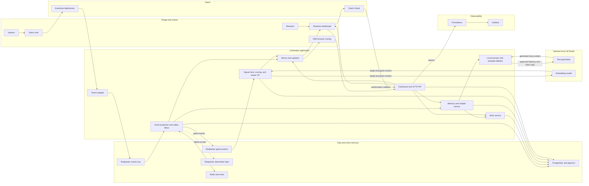

# Lorekeeper

Lorekeeper pitch: **Chat hunts a hidden word drawn from its inside jokes, guided by meaning-based heat.** Streamer-approved observations seed the puzzle; a local embedding model scores guesses, and the answer reveals how it connects to the community memory.

## The live story loop

1. A streamer approves a recurring community observation. LM Studio can paraphrase it and create a research charm, a lore-boss name, and an accessible ability. If generation fails, curated templates are used.
2. The streamer opens a field study. Viewers vote with `!vote A` or `!vote B`: A deploys the charm and reveals hint one immediately; B preserves the sample and extends the hunt by 20 seconds while keeping hint one sealed initially.
3. The lore boss opens a 90-second signal hunt. Chat guesses with `!guess WORD`. Local embeddings compare each guess to the hidden lore-linked target and show shared heat; the exact word solves the encounter. Guesses are moderated and rate limited per viewer, and the target stays private until the round resolves. If a Memory seeds multiple Hunts, Lorekeeper excludes answers already used for that Memory.
4. The OBS overlay shows the lore boss, clue, timed hints, best heat, the five closest guesses with rank, recent guesses, and countdown.
5. At round end, participants earn persistent XP and titles. The closest guess earns a bonus; tied closest guesses share it, and guesses that improve the shared best score earn assist credit. `!whatdoyouknow` reports a viewer's saved lore and game profile; `!forgetme` deletes both.

The default vote window is 45 seconds and the signal hunt is 90 seconds. Set `LOREKEEPER_CHAPTER_VOTE_SECONDS` to 15-180 seconds and `LOREKEEPER_SIGNAL_SECONDS` to 45-180 seconds. For the real semantic game, run an embedding model in LM Studio, set `EMBEDDING_PROVIDER=lm_studio`, set `EMBEDDING_MODEL` to its exact model ID, and set `EMBEDDING_DIMENSIONS=768` for the Nomic 768 model used in this setup. Guess scoring does not fall back to feature hashing. Ordinary chat messages are not sent to a text-generation LLM; guesses go to the local embedding endpoint for scoring.

On first startup, Lorekeeper embeds the bundled 5,000-word English noun/adjective reference list using the configured embedding model and caches the vectors under `data/` (Docker: `/app/data`). Each Hunt saves the target's sorted reference similarities and grades guesses by percentile rank, so unrelated words do not all appear nearly solved. Heat tiers are based on the top 1%, 5%, 15%, and 40%; exact spelling solves the Hunt. The dashboard and overlay show the five closest guesses as `#N closest`. To inspect a target and sample guesses against your live local model, run `python tools/heat_check.py comet sky orbit telescope` from the repository root.

For a judge or rehearsal machine without LM Studio, set `EMBEDDING_PROVIDER=demo_lexicon`. This **offline practice mode** uses bundled, hand-curated concept vectors and a small listed vocabulary; it is not an open-vocabulary embedding model. The dashboard exposes the accepted word list during an encounter. The LLM narrator is optional in both modes.

Guess display has a normalized built-in safety filter and word-only validation. Add channel-specific terms to `LOREKEEPER_GUESS_BLOCKLIST` as a comma-separated list and keep Twitch AutoMod/moderation enabled; no local blocklist can cover every slur, spelling variant, or language. Filtered terms are not embedded or shown in the overlay feed. Guess scoring p95 is shown during a round and exported as `lorekeeper_guess_embedding_latency_seconds`; under 1 second is a rehearsal target to measure, not a guaranteed result.

### Optional local LM Studio narrator

In LM Studio, load an instruct model and start its OpenAI-compatible local server on port 1234. If Lorekeeper runs in Docker, enable LM Studio's **Serve on Local Network** option so the container can reach the host. Set these values in `.env` (the Docker service reaches LM Studio on the host through `host.docker.internal`):

```dotenv
LOREKEEPER_LLM_PROVIDER=lm_studio
LOREKEEPER_LLM_BASE_URL=http://host.docker.internal:1234/v1
LOREKEEPER_LLM_MODEL=
LOREKEEPER_LLM_TIMEOUT_SECONDS=8
```

Leave the model blank to use the model loaded in LM Studio. For Lorekeeper running directly on Windows instead of Docker, use `http://localhost:1234/v1`. If LM Studio is unavailable, times out, or returns invalid output, curated templates are used. Chat text is treated as untrusted data and the endpoint must be local.

## Run with real Twitch

### Twitch app setup

In the [Twitch Developer Console](https://dev.twitch.tv/console/apps), create an application and set its redirect URL to the value in `TWITCH_REDIRECT_URI`. This project defaults to `http://localhost:8787/auth/callback`. If Twitch requires HTTPS for your app, use an HTTPS tunnel and set the same tunnel callback in both Twitch and `.env`. EventSub uses an outbound WebSocket connection, so no public webhook is needed.

### Environment and services

In PowerShell, from the repository directory:

```powershell
Copy-Item .env.example .env
```

Set `TWITCH_CLIENT_ID` and `TWITCH_CLIENT_SECRET` in `.env`. Generate a token-encryption key and set `TOKEN_ENCRYPTION_KEY`:

```powershell
python -c "from cryptography.fernet import Fernet; print(Fernet.generate_key().decode())"
```

For the live signal-hunt feature, load an embedding model in LM Studio and set `EMBEDDING_PROVIDER=lm_studio`, `EMBEDDING_MODEL` to the exact loaded model ID, and `EMBEDDING_DIMENSIONS=768`. Set `LOREKEEPER_LLM_PROVIDER=lm_studio` separately if you also want LM Studio to write the lore-linked target and clues; otherwise the game uses a lore-word fallback.

Start the services with Docker Desktop:

```powershell
docker compose up --build
```

This starts Lorekeeper, PostgreSQL/pgvector, Redpanda, Redis, Prometheus, and Grafana. Lorekeeper is at `http://localhost:8787`; use `http://localhost:8787/overlay` as an OBS Browser Source. Grafana is at `http://localhost:3000` (`admin`, password from `GRAFANA_PASSWORD`, default `lorekeeper-demo`).

Open the dashboard, choose **Connect Twitch**, and authorize the broadcaster account. Wait for **Live · EventSub** before starting a chapter. The connected channel name appears in the dashboard.

### Seed a useful community observation

Lorekeeper only uses approved observations as story clues. In live channel chat, share a short, non-sensitive callback from a science stream, such as “Remember when chat spotted the loose cable during the experiment?” It will appear in **Community Observations**. Approve it before starting a field study. Streamer approval is deliberate: unreviewed messages never become the story seed.

### Start the audience chapter

Keep the OBS overlay open. Start a field study and let chat choose with `!vote A` or `!vote B`. Reveal the finding, then choose **Start lore boss encounter**. On Twitch chat, viewers enter `!guess WORD`; the overlay shows the clue, timed hints, recent guesses, and the closest signal heat. Exact answer or timeout reveals the target. When it resolves, the dashboard shows researcher XP/titles and lets you start the next field study. **Preview with 200 simulated guessers** is clearly labelled synthetic activity; it does not create real Twitch votes.

For a detailed real-Twitch test and rehearsal sequence, see [docs/live_twitch_test_guide.md](docs/live_twitch_test_guide.md). For the timed demo narration, see [docs/demo_story.md](docs/demo_story.md).

## Privacy and safety

- Lore stays pending until the streamer approves it.
- Vote/game records use Twitch user IDs for deduplication and credit. `!forgetme` removes the viewer's derived lore, relics, chapter text derived from that memory, action history, XP/profile, and vote records, then suppresses future learning and game actions for that account. Any chapter whose source Memory is deleted is scrubbed and cancelled so it cannot block later hunts; another approved Memory can seed the next chapter.
- `!whatdoyouknow` sends the viewer their saved Memory and game title/XP through a private Twitch Whisper; it is not shown on the shared overlay. `!forgetme` deletes the viewer's data, suppresses future learning, and privately whispers a confirmation. The viewer can explicitly opt back in later with `!rememberme`; new Memories still require streamer approval. Twitch authorization needs `user:manage:whispers`, a verified sender phone number, and recipients who accept Whispers; delivery can be blocked by recipient settings and Twitch may silently filter messages.
- The dashboard panic mute immediately stops mascot speech.
- Twitch tokens are encrypted at rest in `data/twitch_tokens.bin`. Keep `.env` and its key private.
- Raw events are retained for seven days by default. Redpanda is append-only, so raw log records can remain until topic retention expires.

## Architecture and observability

`server.py` composes the application. `lorekeeper/twitch.py` handles OAuth and EventSub, `lorekeeper/projection.py` projects live events/lore and sends `!guess` events into the durable `game.actions` topic, `lorekeeper/signal_game.py` grades semantic guesses and manages live encounters, `lorekeeper/narrator.py` provides local LM Studio story enrichment with template fallback, `lorekeeper/relics.py` manages stream-aware artifacts, and `lorekeeper/story.py` manages chapter votes. `lorekeeper/http.py` serves the dashboard/API and overlay. The Compose deployment runs these application modules with PostgreSQL, Redpanda, and Redis as separate services.



**Flow:** Twitch chat enters through EventSub and is appended to Redpanda before the projection updates PostgreSQL. Chat guesses use a separate `game.actions` topic. The dashboard and OBS overlay read the resulting state through HTTP and server-sent updates. Local embeddings score Hunt words; the optional text model receives approved Memory/story context, with template fallbacks if unavailable. Prometheus scrapes application metrics for Grafana.

Check readiness at `http://localhost:8787/api/ready` and metrics at `http://localhost:8787/metrics`. The dashboard's **Rehearsal & safety** panel includes a raid replay, a prompt-injection profile, and a 1,000-event load run; all are explicitly synthetic and cannot create lore. For a sustained load report, run `python tools/load_test.py --duration 60 --rate 10000`; report measured results, not the requested target. Synthetic replay/load traffic is for engineering rehearsal and is not a substitute for the real Twitch demo.

## Routes

| Method | Path | Purpose |
|---|---|---|
| GET | `/auth/connect` | Start Twitch OAuth |
| GET | `/auth/callback` | Validate authorization and start EventSub |
| GET | `/api/state` | Dashboard, lore, relic vault, chapter, and Twitch status |
| GET | `/api/stream` | Live server-sent events for dashboard and overlay |
| POST | `/api/chapter/start` | Start a chapter from approved lore |
| POST | `/api/chapter/close` | Close the active vote and reveal the result |
| POST | `/api/game/start` | Start the resolved chapter's live Twitch boss encounter |
| POST | `/api/game/replay` | Preview a separate simulated 200-viewer encounter |
| POST | `/api/lore/action` | Approve, reject, restore, retire, or delete a memory |
| POST | `/api/settings/mute` | Set panic mute |
| POST | `/api/privacy/forget` | Delete a viewer's derived memory |
| GET | `/api/ready` | Database, event log, and Redis readiness |
| GET | `/metrics` | Prometheus metrics |


## Hackathon submission

The [Codex x TwitchCon Hackathon](https://twitchcon-codex.devpost.com/) asks for the project repository, a public YouTube demo up to three minutes, a project description, and the Codex session ID. The demo should show this chapter loop working on a real Twitch channel and include how Codex was used to build it.

### Codex Session Details

```text
>_ OpenAI Codex (v0.164.0)

Model:              GPT-6-Luna (reasoning medium, summaries auto)
Model Provider:     OpenAI
Directory:          ~\OneDrive\Desktop\Lorekeeper
Permissions:        Workspace (granular)
Agents.md:          <none>
Account:            aaryavartjoshi@gmail.com (Go)
Collaboration Mode: Default
Session ID:         01a17e90-6f6b-7640-b71f-e99fa3e451b9

Monthly Limit:      [████████████████████] 100% left (resets 23:42 on 26 Nov)
Usage Reset:        1 reset available (run /usage)
```
